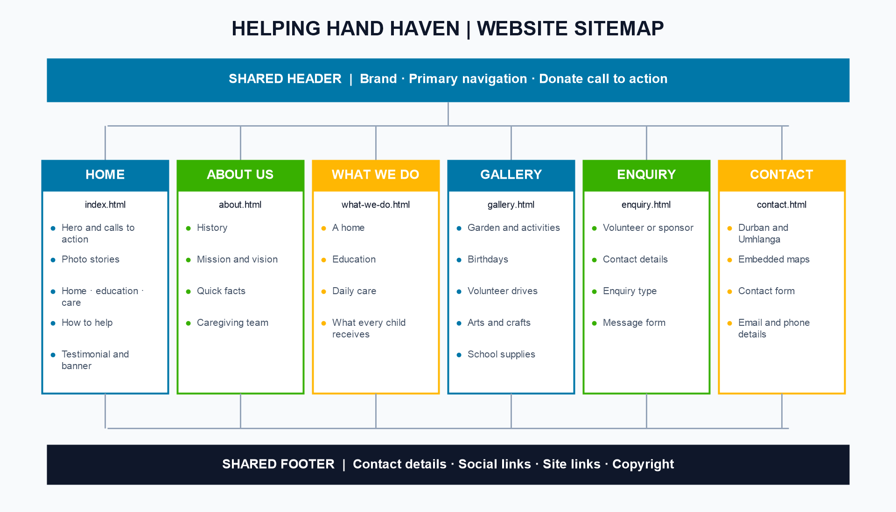

# Helping Hand Haven &mdash; Website Project

## Student Information

- **Student Name:** Luyanda Shandu
- **Student Number:** ST10514191
- **Module:** WEDE5020 &ndash; Web Development (Introduction)
- **Programme:** Higher Certificate in Mobile Application and Web Development

## Project Overview

Helping Hand Haven is a non-profit organisation founded in 2000 by Luyanda Prince Shandu. It provides underprivileged children and runaways who have not been adopted with a safe, long-term home, raising them together as siblings with education, care, and support &mdash; everything a child would receive in a normal household. This repository contains the website built for Helping Hand Haven as part of the WEDE5020 Portfolio of Evidence.

## Website Goals and Objectives

- Increase donations from individuals and corporate donors.
- Raise awareness of the cause and the spirit of *umuntu ngumuntu ngabantu*.
- Recruit volunteers.
- Support placement enquiries from social workers.

**KPIs:** number of donation form submissions per month, number of volunteer sign-ups per month, and number of enquiries from social workers and sponsors.

## Key Features and Functionality

- Homepage &ndash; hero section, intro, Donate/Volunteer calls to action, navigation, a "How You Can Help" step list, and a volunteer testimonial.
- About Us &ndash; history, mission/vision, quick facts table, and caregiving team.
- What We Do &ndash; details on the home, education, and daily care, with live service search and sorting.
- Gallery &ndash; searchable, sortable activity photos with a full-size lightbox.
- Enquiry &ndash; a validated volunteer or sponsor form that sends enquiries to the team inbox.
- Contact &ndash; two locations, interactive Google Maps, and a validated contact form.

## Timeline and Milestones

| Milestone | Target Date |
|---|---|
| Project planning & proposal approval | 1 September 2026 |
| HTML structure for all 6 pages (Part 1) | 1 September 2026 |
| CSS styling & responsive design | September 2026 |
| Part 2 submission (visual design complete) | 5 October 2026 |
| JavaScript functionality, forms & SEO (Part 3) | 9 November 2026 |

## Part 1 Details

Part 1 focused on planning and building the site's foundation:

- Selected and had approved the target organisation (Helping Hand Haven, a non-profit).
- Wrote the Website Project Proposal, including goals, KPIs, design direction, and wireframes.
- Built the plain HTML5 skeleton for all 6 pages using semantic tags (`header`, `nav`, `main`, `footer`), with no CSS styling yet (styling begins in Part 2).
- Set up the project folder structure with the CSS and image assets; the shared JavaScript enhancement was added later.

## Part 2 Details (Designing the Visuals)

Part 2 added all CSS styling and responsive design:

- **External stylesheet:** one shared `css/styles.css`, linked from all 6 pages.
- **Base style:** CSS reset, CSS variables for the proposal's colour scheme, 16px root font size and relative units (`rem`, `%`) throughout.
- **Typography:** Poppins (headings) and Open Sans (body), both free Google Fonts (Google Fonts, 2026a; 2026b); a 1.25 "major third" type scale stored in CSS variables and sized in `rem` so it respects the user's browser settings (MDN Web Docs, n.d.b), plus `line-height`, `font-weight` and `letter-spacing`.
- **Layout:** Flexbox for the header and two-column sections; CSS Grid for cards, galleries, team and the footer (using `grid-template-areas`).
- **Decoration and colour:** rounded corners, `box-shadow`, gradients, coloured card borders, circular team photos.
- **Pseudo-classes** (MDN Web Docs, n.d.c): `:hover`, `:focus`, `:focus-visible`, `:active`, `:checked`, `:required:invalid`, `:nth-child`, `:first-child`, `:visited`, `::marker`, `::placeholder`, `::selection`.
- **Responsive design:** CSS media queries cover **1024px**, **768px** and **480px**. A CSS-only checkbox menu keeps navigation available at 1024px and below; the existing multi-column layouts and footer adapt for smaller screens.
- **Responsive images:** each image has srcset and sizes. The six local photos include 480px, 800px, 1200px and 1600px JPEG variants saved at high quality; Pexels images request matching widths from their source. Image display uses a subtle brightness adjustment, and the About page image requests the correct display size. The homepage hero uses a picture element with a mobile source (MDN Web Docs, n.d.d).
- **Accessibility:** visible focus outlines, aria-current="page" on each page's active link, a labelled navigation toggle, and prefers-reduced-motion support.
- **JavaScript enhancement:** Escape closes the compact navigation menu. The service page can be searched and sorted, and the gallery can be searched, sorted, and opened in an accessible lightbox. The contact and enquiry forms validate names, complete email addresses, and exactly 10 phone digits before submitting asynchronously.

### Part 3 Details (Functionality and SEO)

- Contact and enquiry forms validate names, complete email addresses, required details, and exactly 10 phone digits. Invalid fields show a clear browser message.
- Valid forms submit asynchronously through FormSubmit to `info@helpinghandhaven.org.za`; the forms show an accessible success or retry message and retain an email link if the service is unavailable.
- The service page can filter and alphabetically sort its home, education, and care sections.
- The gallery can search and sort photos, open full-size images in a keyboard-accessible lightbox, and navigate between photos.
- Google Maps embeds remain interactive. Small scroll reveals respect the device's reduced-motion preference.
- Each page has a unique title, description, and keyword list. `robots.txt` and `sitemap.xml` describe the planned `helpinghandhaven.org.za` site.

### Before publishing

- FormSubmit sends submissions to the contact inbox. The inbox owner must confirm the first activation email before delivery is enabled; first-use submissions are held until confirmation.
- Open the site through a local web server while developing. FormSubmit does not accept submissions from pages opened directly as `file://` files.
- If the published host differs from `helpinghandhaven.org.za`, update the site URLs in `robots.txt`, `sitemap.xml`, and the forms' `_url` fields.
- Form details pass through FormSubmit, an external email service, before reaching the inbox.
- Add official social profile URLs and any backlinks after the organisation provides them; the archive does not use guessed profile links.

## Screenshot evidence

The earlier screenshot table referenced files that were missing from the supplied archive. This corrected archive does not claim to include browser screenshots or visual test results. Capture each page at desktop, tablet and mobile widths, including the open mobile menu, before submitting the final evidence.

## Images

The six local image originals and their responsive variants are illustrative stock photos, not photographs of Helping Hand Haven residents. The site also uses Pexels stock photos; their source assets are listed in References.

## Technical Requirements

| Technology | Why it was chosen |
|---|---|
| **HTML5** | Semantic elements (`header`, `nav`, `main`, `section`, `footer`) give the pages a clear structure that is accessible to screen readers and search engines (W3Schools, n.d.). |
| **CSS3** | Handles all styling in one external file, so a design change is made once and applies to every page. Flexbox and Grid provide responsive layouts without extra libraries (MDN Web Docs, n.d.f). |
| **JavaScript** | A shared script handles mobile navigation, service search and sort, a keyboard-accessible gallery lightbox, subtle scroll reveals, and client-side form validation. Valid forms submit through FormSubmit to the site inbox. |
| **GitHub + GitHub Pages** | Free version control and free static hosting, which suits a non-profit with no hosting budget (GitHub Docs, n.d.). |
| **Visual Studio Code** | Free code editor with Live Server and browser DevTools for testing responsive layouts. |
| **Domain** | `helpinghandhaven.org.za` &ndash; the `.org.za` extension is the South African extension intended for organisations (ZADNA, n.d.). |

## Budget (revised after Part 1 feedback)

| Item | Estimate | Where the figure comes from |
|---|---|---|
| `.org.za` domain | R99 &ndash; R150 per year | A South African registrar lists `.org.za` at R99 per year (WHTop, 2026); a local registrar guide gives about R90&ndash;R150 for `.za` extensions (Register Domain SA, n.d.). |
| Hosting | R0 | GitHub Pages free tier. |
| Development | R0 | Built by the student developer as coursework. |
| Images | R0 | Free-licence or own photographs only, each credited in References. |
| Maintenance | R0 &ndash; R500 per year | Occasional content updates by volunteers; allowance for a small paid change if needed. |
| **Total** | **about R99 &ndash; R650 per year** | Lean budget realistic for a small non-profit. |

## File and Folder Structure

~~~
/
├── .classroom50.yaml
├── .github/
│   └── workflows/
│       └── autograde.yaml
├── index.html, about.html, what-we-do.html, gallery.html, enquiry.html, contact.html
├── README.md
├── CHANGELOG.md
├── robots.txt
├── sitemap.xml
├── css/
│   └── styles.css
├── js/
│   └── script.js
└── images/
    ├── six original JPG photos and matching -480, -800, -1200 and -1600 JPG variants
    └── sitemap.png
~~~

## Sitemap

Drawn as a diagram (see image) instead of plain text:



Text version:

```
Helping Hand Haven
├── Homepage (index.html)
├── About Us (about.html)
├── What We Do (what-we-do.html)
├── Gallery (gallery.html)
├── Enquiry (enquiry.html)
└── Contact (contact.html)
```

### Changelog

The full record is in [CHANGELOG.md](CHANGELOG.md). Key work includes the six-page structure, shared stylesheet, responsive layouts and images, working navigation, client-side form validation, and the sitemap. The latest rubric corrections and JavaScript enhancement are dated 9 November 2026.

## References

Coddy.tech (n.d.) *Learn HTML*. Available at: https://coddy.tech/landing/html (Accessed: 1 September 2026).

freeCodeCamp.org (2022) *Learn HTML &ndash; Full Tutorial for Beginners*. [YouTube]. Available at: https://www.youtube.com/watch?v=kUMe1FH4CHE (Accessed: 1 September 2026).

HirenEmeris (n.d.) *student_site* [GitHub repository]. Available at: https://github.com/HirenEmeris/student_site (Accessed: 1 September 2026).

SuperSimpleDev (n.d.) *HTML and CSS Full Course*. [YouTube]. Available at: https://youtu.be/G3e-cpL7ofc (Accessed: 1 September 2026).

W3Schools (n.d.) *HTML id Attribute*. Available at: https://www.w3schools.com/html/html_id.asp (Accessed: 1 September 2026).

GitHub Docs (n.d.) *What is GitHub Pages?* Available at: https://docs.github.com/en/pages/getting-started-with-github-pages/what-is-github-pages (Accessed: 5 October 2026).

MDN Web Docs (n.d.f) *CSS layout*. Mozilla. Available at: https://developer.mozilla.org/en-US/docs/Learn_web_development/Core/CSS_layout (Accessed: 5 October 2026).


Register Domain SA (n.d.) *Domain Registration in South Africa: Costs and Considerations*. Available at: https://www.registerdomain.co.za/blog/?p=811 (Accessed: 5 October 2026).

WHTop (2026) *domains.co.za pricing (lists .org.za at R99.00 per year)*. Available at: https://www.whtop.com/plans/domains.co.za/141708 (Accessed: 5 October 2026).

ZADNA (n.d.) *.za Domain Name Authority*. Available at: https://www.zadna.org.za (Accessed: 5 October 2026).

118Group (n.d.) *Color theory 101: the ultimate nonprofit guide*. Available at: https://118group.com/research/color-theory-101-the-ultimate-nonprofit-guide/ (Accessed: 31 August 2026).

Door of Hope (2026) *Door of Hope &ndash; Giving Hope, Changing Futures*. Available at: https://doorofhope.co.za/ (Accessed: 1 September 2026).

Google Fonts (2026a) *Poppins*. Available at: https://fonts.google.com/specimen/Poppins (Accessed: 5 October 2026).

Google Fonts (2026b) *Open Sans*. Available at: https://fonts.google.com/specimen/Open+Sans (Accessed: 5 October 2026).

Help A Child South Africa (2026) *Help A Child South Africa*. Available at: https://helpachild.org.za/ (Accessed: 1 September 2026).

MDN Web Docs (n.d.a) *Using media queries*. Mozilla. Available at: https://developer.mozilla.org/en-US/docs/Web/CSS/CSS_media_queries/Using_media_queries (Accessed: 5 October 2026).

MDN Web Docs (n.d.b) *CSS values and units*. Mozilla. Available at: https://developer.mozilla.org/en-US/docs/Learn_web_development/Core/Styling_basics/Values_and_units (Accessed: 5 October 2026).

MDN Web Docs (n.d.c) *Pseudo-classes*. Mozilla. Available at: https://developer.mozilla.org/en-US/docs/Web/CSS/Pseudo-classes (Accessed: 5 October 2026).

MDN Web Docs (n.d.d) *Responsive images*. Mozilla. Available at: https://developer.mozilla.org/en-US/docs/Learn_web_development/Core/Structuring_content/HTML_images#responsive_images (Accessed: 5 October 2026).

MDN Web Docs (n.d.e) *prefers-reduced-motion*. Mozilla. Available at: https://developer.mozilla.org/en-US/docs/Web/CSS/@media/prefers-reduced-motion (Accessed: 5 October 2026).

Open Arms Home for Children (2026) *Open Arms | Embrace our Mission*. Available at: https://www.openarmshome.com/ (Accessed: 1 September 2026).

Pexels (n.d.) *Homepage hero*, photo asset 33168484. Available at: https://images.pexels.com/photos/33168484/pexels-photo-33168484.jpeg (Accessed: 9 November 2026).
Pexels (n.d.) *Homepage learning story*, photo asset 5088174. Available at: https://images.pexels.com/photos/5088174/pexels-photo-5088174.jpeg (Accessed: 9 November 2026).
Pexels (n.d.) *Homepage playtime story*, photo asset 19255400. Available at: https://images.pexels.com/photos/19255400/pexels-photo-19255400.jpeg (Accessed: 9 November 2026).
Pexels (n.d.) *Homepage bedtime story*, photo asset 5951837. Available at: https://images.pexels.com/photos/5951837/pexels-photo-5951837.jpeg (Accessed: 9 November 2026).
Pexels (n.d.) *Caregiving team portrait*, photo asset 20209020. Available at: https://images.pexels.com/photos/20209020/pexels-photo-20209020.jpeg (Accessed: 9 November 2026).
Pexels (n.d.) *Caregiving team portrait*, photo asset 12437056. Available at: https://images.pexels.com/photos/12437056/pexels-photo-12437056.jpeg (Accessed: 9 November 2026).
Pexels (n.d.) *Caregiving team portrait*, photo asset 2362887. Available at: https://images.pexels.com/photos/2362887/pexels-photo-2362887.jpeg (Accessed: 9 November 2026).
Pexels (n.d.) *Home service*, photo asset 4221413. Available at: https://images.pexels.com/photos/4221413/pexels-photo-4221413.jpeg (Accessed: 9 November 2026).
Pexels (n.d.) *Education service*, photo asset 8617993. Available at: https://images.pexels.com/photos/8617993/pexels-photo-8617993.jpeg (Accessed: 9 November 2026).
Pexels (n.d.) *Care service*, photo asset 7879719. Available at: https://images.pexels.com/photos/7879719/pexels-photo-7879719.jpeg (Accessed: 9 November 2026).

Wireframes 1&ndash;5 (n.d.) *Helping Hand Haven wireframes* [Figma Sites]. Available at: https://ivory-memo-95080924.figma.site/ (Accessed: 1 September 2026).

Wireframe 6 (n.d.) *Helping Hand Haven sitemap* [Figma Sites]. Available at: https://load-nova-68778060.figma.site/ (Accessed: 1 September 2026).

FormSubmit (n.d.) *AJAX Documentation*. Available at: https://formsubmit.co/ajax-documentation (Accessed: 9 November 2026).
FormSubmit (n.d.) *Form Documentation*. Available at: https://formsubmit.co/documentation (Accessed: 9 November 2026).

